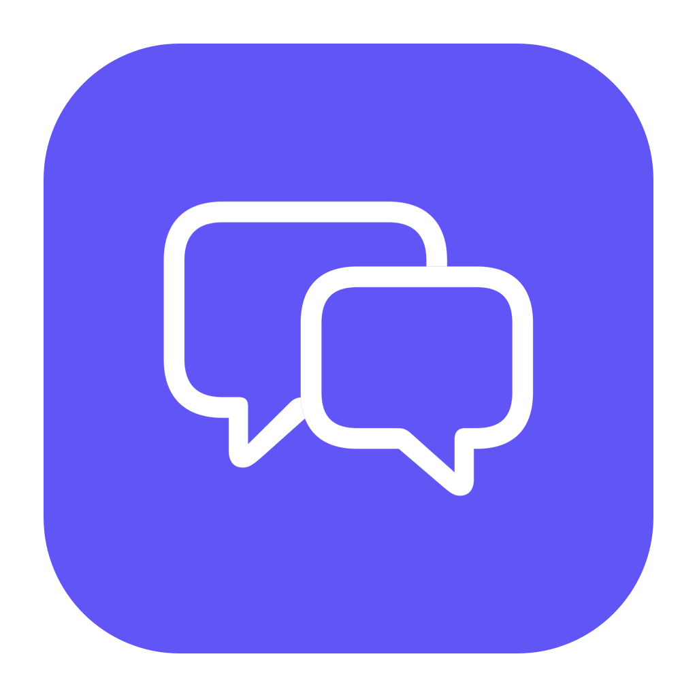
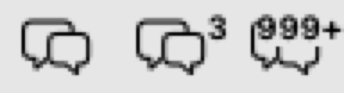

<p align="center">
  
</p>

<h1 align="center">Msgbox</h1>

<p align="center"><strong>See which chat apps need your attention, right from the Mac menu bar.</strong></p>

<p align="center">macOS 26+ · Works offline · <a href="README.zh-CN.md">简体中文</a></p>

If you use WeChat for one group, QQ for another, and Telegram or Discord for the rest, checking what needs a reply can mean opening four apps. Msgbox puts their Dock badges in one place. Glance at the total, click the chat bubbles to see which app has unread activity, then click its row to open it.

<p align="center">
  
</p>

<p align="center"><em>Enlarged preview of the menu bar icon with zero, three, and 1,000 or more unread.</em></p>

[Get started](#get-started) · [Supported apps](#supported-apps) · [Privacy](#privacy) · [Troubleshooting](#troubleshooting) · [Contribute](#contribute)

## Get started

**You need macOS 26 or later and Xcode 26 or later.** This preview is available as a source build. The app supports English and Simplified Chinese and follows your macOS language preferences. To change only Msgbox, add it under **System Settings → General → Language & Region → Applications**, choose a language, and relaunch it.

1. Clone this repository or choose **Code → Download ZIP** on GitHub and unzip it.
2. Open `Msgbox.xcodeproj` in Xcode, select **Msgbox → My Mac**, and press **⌘R**. The Debug build uses local ad-hoc signing and needs no Apple Developer signing certificate.
3. In Msgbox, click **Open Accessibility Settings…**. Under **System Settings → Privacy & Security → Accessibility**, enable the copy you are running, **Msgbox Debug** for the Xcode build. Return to Msgbox. If macOS has yet to apply the permission, quit and reopen that copy.
4. Open one of the supported chat apps. Click the chat bubbles in the menu bar to see its badge. In **Settings… → Apps to Monitor**, choose the apps you want to include. Msgbox remembers your choices locally.

You can close the list window and keep using the menu bar. For a locally signed install in Applications and the optional launch-at-login setting, see [Local installation](#local-installation).

## Supported apps

| App | macOS bundle ID | What Msgbox counts |
| --- | --- | --- |
| WeChat | `com.tencent.xinWeChat` | Numeric Dock badge |
| QQ | `com.tencent.qq` | Numeric Dock badge |
| Telegram | `com.tdesktop.Telegram` | Numeric Dock badge |
| Discord | `com.hnc.Discord` | Exact numeric Dock badge. Activity dots, `!`, and abbreviated badges such as `99+` are ignored. |

Compatibility depends on the installed edition and whether it exposes a badge in the Dock. The total covers the selected, running apps and reflects their badge settings and notification rules.

| Display | Meaning |
| --- | --- |
| `22` | The reported numbers add up to 22, for example `12 + 3 + 7`. |
| `12+` | 12 is the known total. At least one app has an unread indicator without an exact count, or its status could not be read. |
| `?` | The total is incomplete and there is no known positive count. Open the list to see why. |
| Bubbles only | The detected total is zero. |
| `999+` | The known total is at least 1,000. Open the list for the full known count. |

## Privacy

Msgbox runs offline without an account or telemetry. It uses macOS Accessibility to read metadata from the Dock items of the apps you select. Message text, chat windows, notifications, and chat databases are outside that path. Msgbox keeps your app selection in macOS preferences and does not keep a history of badge counts.

Accessibility is a broad macOS permission. You grant it to Msgbox so it can query the Dock. The implementation is in [DockReader.swift](Msgbox/DockReader.swift). The app does not request Screen Recording, Full Disk Access, or notification permission. Polling pauses when the Mac or its display sleeps.

## Troubleshooting

- **The menu bar icon is missing.** Check **System Settings → Menu Bar** and allow Msgbox or Msgbox Debug to appear. This controls visibility. Badge reading is controlled separately under Accessibility.
- **An app shows `?` or reports an unknown status.** Check that it is running, its icon is in the Dock, and Accessibility is enabled for the exact Msgbox build you opened. The Dock attribute Msgbox reads, `AXStatusLabel`, is undocumented and may behave differently across macOS or chat app versions.
- **Telegram shows a number elsewhere but has no Dock badge.** Check **System Settings → Notifications → Telegram** and enable notifications and application icon badges. Msgbox reads the Dock icon. Banners and sounds are optional.
- **Discord has unread activity but the total stays the same.** Enable unread badges in **Discord → User Settings → Notifications** and application icon badges in macOS if available. Only an exact number in the Dock contributes to the total.
- **To uninstall.** If you enabled **Launch at Login**, turn it off in Msgbox settings. Quit Msgbox, remove its entry from **Accessibility**, and delete the copy you ran.

## Local installation

For personal use in `/Applications`, quit Msgbox and run the following from the repository root with Python 3 and a valid **Apple Development** signing identity in your Keychain.

```sh
python3 scripts/install.py
open /Applications/Msgbox.app
```

The installer builds Release, checks that the update satisfies the installed copy's signing requirements, and backs up the previous app to `build/installed-backups/`. If multiple signing identities are present, set `MSGBOX_SIGNING_IDENTITY` to the intended certificate's 40-character fingerprint. For a one-time upgrade from an older ad-hoc installation, use `python3 scripts/install.py --migrate-signature` and be prepared to grant Accessibility again.

The local installer produces an Apple Development build for your own Mac. Public distribution would require a separate Developer ID signing and notarization workflow. Once opened from Applications, Msgbox can be set to launch at login in **Settings… → General**.

## Contribute

A compatibility report from another Mac is especially valuable. To report a badge mismatch, open a GitHub issue with the macOS version, chat app version and bundle ID, the visible Dock badge, the Msgbox result, and steps to reproduce it. Badge values and steps are enough. Please leave out message text and account details.

Current testing priorities are Discord numeric badges for direct messages and mentions, clearing the badge after reading, and compatibility across macOS and app versions. The unit tests cover Discord's numeric-only rule. End-to-end Discord badge arrival and clearing still need real-app verification.

Msgbox is written in Swift 6 with SwiftUI and AppKit and has no third-party dependencies. To add an app, start with the bundle-ID list in [Monitor.swift](Msgbox/Monitor.swift) and verify its real Dock badge before submitting a change. The [test suite](MsgboxTests/UnreadStateTests.swift) covers badge parsing, missing permissions, incomplete totals, and monitoring behavior.

To build or run the checks from the repository root:

```sh
xcodebuild -project Msgbox.xcodeproj -scheme Msgbox -configuration Debug \
  -destination 'platform=macOS' -derivedDataPath build build
xcodebuild -project Msgbox.xcodeproj -scheme Msgbox -configuration Debug \
  -destination 'platform=macOS' -derivedDataPath build test
python3 scripts/audit.py
```

The Debug app is at `build/Build/Products/Debug/Msgbox.app`. The [manual acceptance checklist](docs/HUMAN_ACCEPTANCE.md) covers checks that need the real macOS interface and chat clients. With a signed Release build, `python3 scripts/test_install.py` verifies signature checks without installing, and `python3 scripts/idle_measure.py` measures the app it launches. Quit other Msgbox instances before measuring.

## License

Msgbox is available under the [MIT License](LICENSE).
